# 화면 디자인 검토 및 수정

2026-09-07. 기존 청록색 디자인을 유지하며 Android 네이티브 화면을 점검하고 수정했습니다.

## 검토 방법과 범위

이번 작업에서 실행 중인 앱을 ADB `screencap`으로 직접 캡처했습니다. 이전 도움말의 이미지는 검토 근거로 사용하지 않았습니다. 기본 환경은 Android 에뮬레이터 1080×2220, 440dpi이며, 880×1760(320dp 폭)·글자 130%도 추가 확인했습니다. 에뮬레이터 해상도와 글자 설정은 원래대로 복원했습니다.

## 주요 발견과 조치

| 화면 | 발견 | 수정 |
|---|---|---|
| 1. 준비 | 좌우 여백 0, 긴 설명과 설정 버튼의 시각적 구분 부족 | 좌우 20dp, 설정별 16dp 내부 여백, 제목·설명 위계 정리 |
| 2. 입력 연습 | 돌아가기 버튼이 본문 전체 폭을 차지, 필드가 가장자리에 붙음 | 48dp 보조 탐색 버튼, 필드 내부 16dp, 키보드 위에 선택한 필드 표시 |
| 3. 사진 연습 선택 | 화면 끝에 붙은 제목·설명, 과도한 기본 버튼 그림자 | 동일한 화면 여백, 제목 26sp·설명 14sp, 평면 버튼 |
| 4. 이미지 미리보기 | 연습 결과와 작업 영역의 구분 부족, 하단 공간 활용 불균형 | 결과 카드 분리, 화면 높이에 맞는 작업 영역, 읽기 버튼 하단 고정 |
| 5. 줄 선택 | 가운데 정렬된 내용이 버튼 목록처럼 보여 읽기 어려움 | 원문 좌측 정렬, 행 사이 8dp, 긴 목록 스크롤 |
| 6. 결과 확인 | 인식값과 주변 설명의 시각적 구분 부족 | 연한 청록색 결과 영역, 입력 버튼 하단 고정 |
| 7. 숫자 수정 | 완료 버튼이 숫자 키 아래로 밀려 보이지 않음 | 불필요한 축소 원본 제거, 취소·완료 하단 고정, 같은 줄 버튼 높이 통일 |
| 8. 카메라 입력기 | 모드 선택과 주요 촬영 버튼의 강조가 경쟁 | 모드는 옅은 선택색·테두리, 촬영만 채움 버튼, 키보드 전환은 보조 버튼 |
| 9. 시스템 파일 선택 | Android가 제공하는 선택 화면 | 시스템 UI 유지. 이미지 선택 후 입력기 미리보기 복귀 확인 |
| 10. 입력 완료 | 다음 동작 위치의 일관성이 약함 | 결과는 연습 카드에 표시, 다음 스캔 버튼은 동일한 하단 위치 |
| 11. 인식 실패 | 오류 안내와 복구 동작의 구분 부족 | 안내 영역 분리, 다시 스캔 버튼 하단 고정, 사진 선택 경로 유지 |

기존의 원본·인식값 비교와 명시적인 입력 확인은 유지했습니다. 촬영·사진 선택·OCR 알고리즘은 변경하지 않았습니다.

## 적용 규칙

- 화면/입력기 좌우: 20dp. 카드 내부: 16dp. 나란한 버튼 사이: 8dp.
- 주요 버튼: 최소 56dp, 일반 버튼: 52dp, 보조 탐색·모드 버튼: 48dp.
- 버튼·입력칸 모서리: 12dp. 기본 입체 그림자 제거, 누름 효과 유지.
- 긴 문구는 줄바꿈하며, 같은 줄의 버튼은 가장 높은 버튼에 맞춥니다.
- 큰 글자에서는 연습 결과 영역도 커집니다. 긴 인식 결과와 수정 키는 스크롤할 수 있습니다.
- 입력·읽기·수정 완료는 스크롤 밖 하단 영역에 배치합니다.

## 변경 전후

각 원본 PNG는 `before/`, `after/`에 있습니다. 화면 번호는 표와 동일합니다.

| 단계 | 변경 전 | 변경 후 |
|---|---|---|
| 1 준비 | 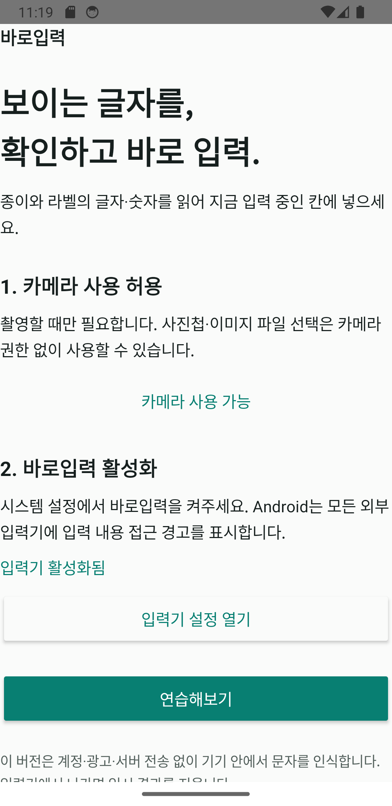 | 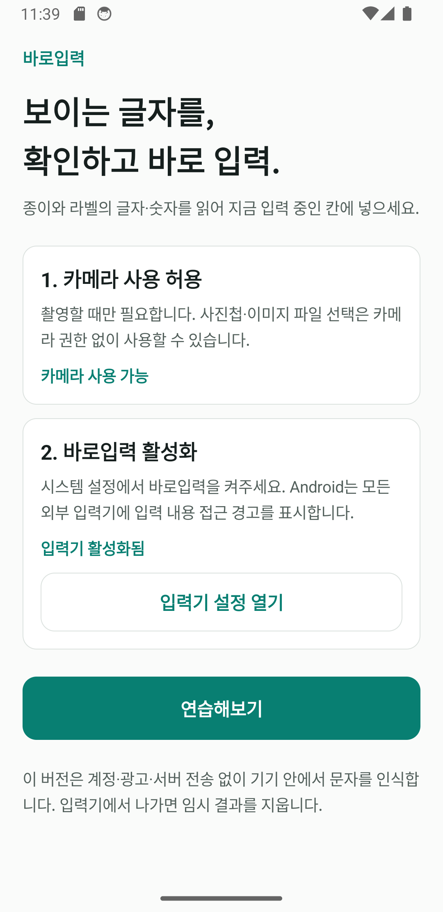 |
| 2 입력 연습 | 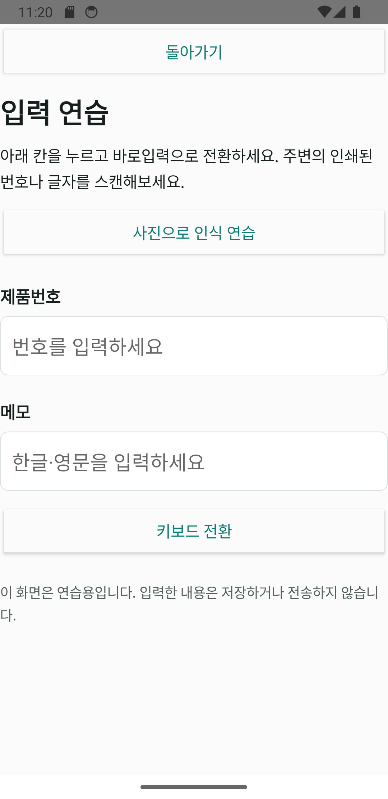 | 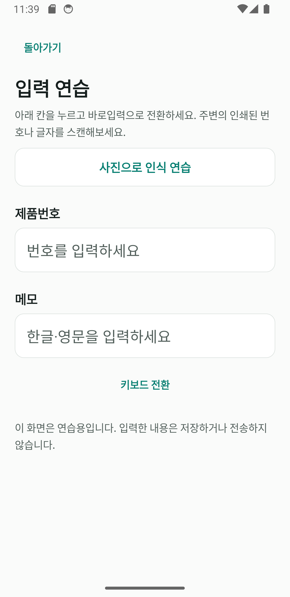 |
| 3 사진 선택 | 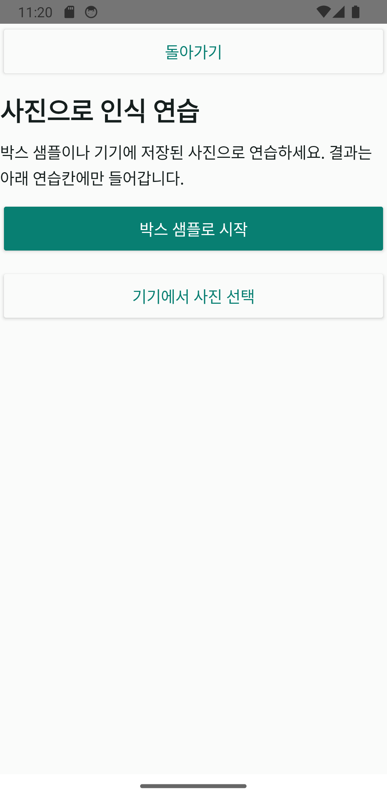 | 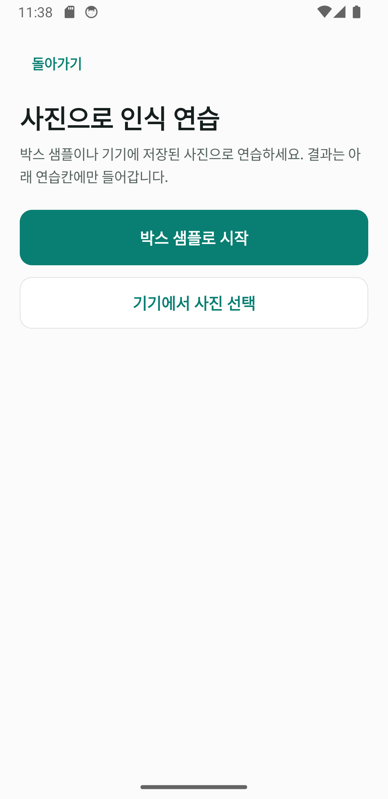 |
| 4 미리보기 | 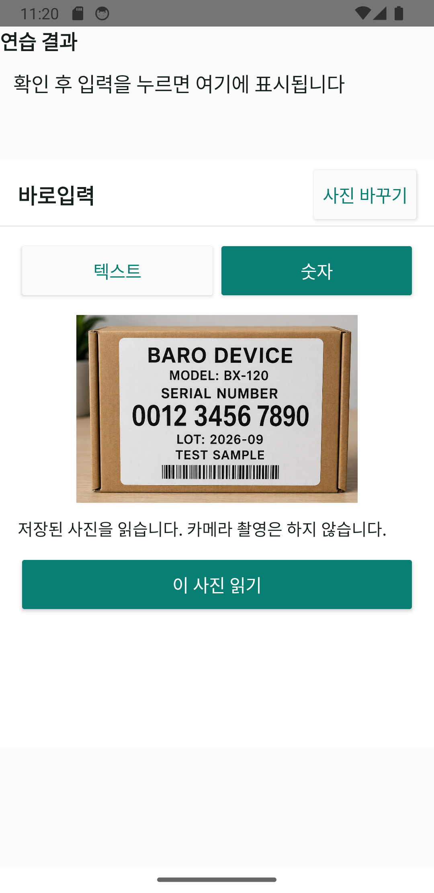 | 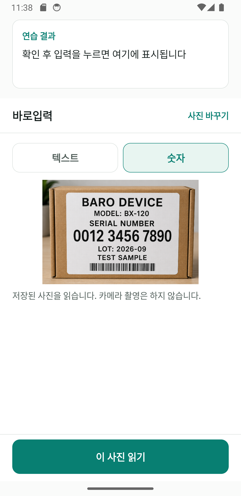 |
| 5 줄 선택 | 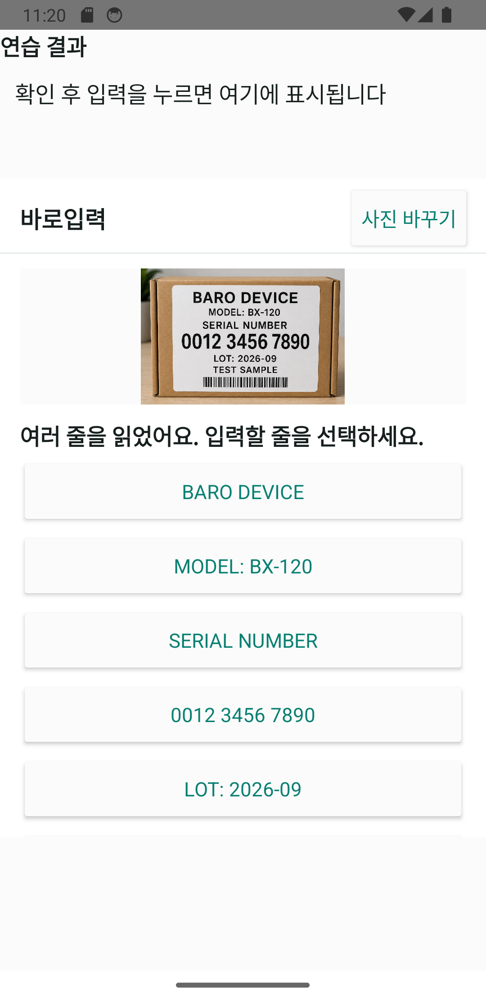 | 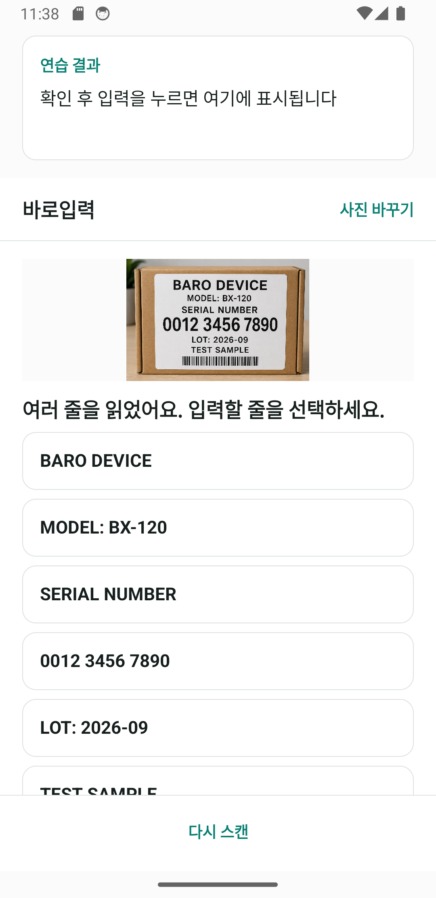 |
| 6 결과 확인 | 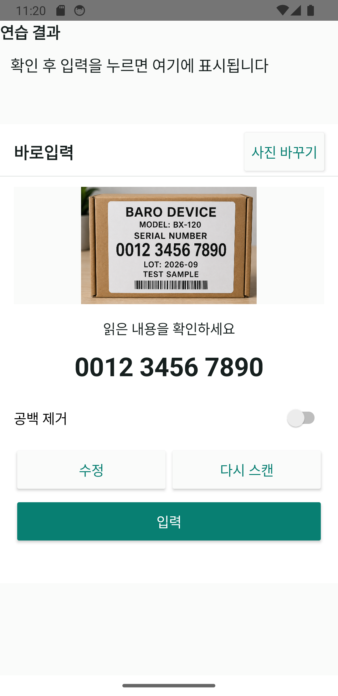 | 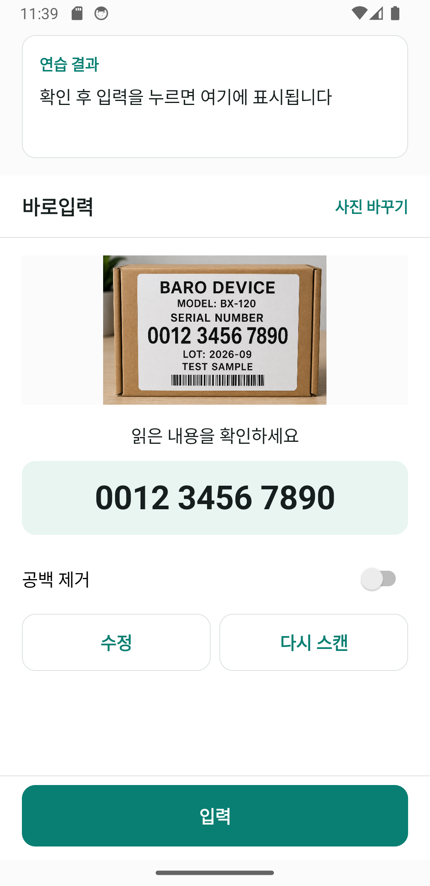 |
| 7 수정 | 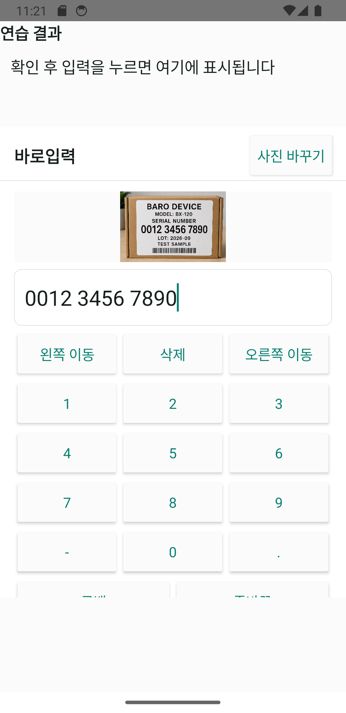 | 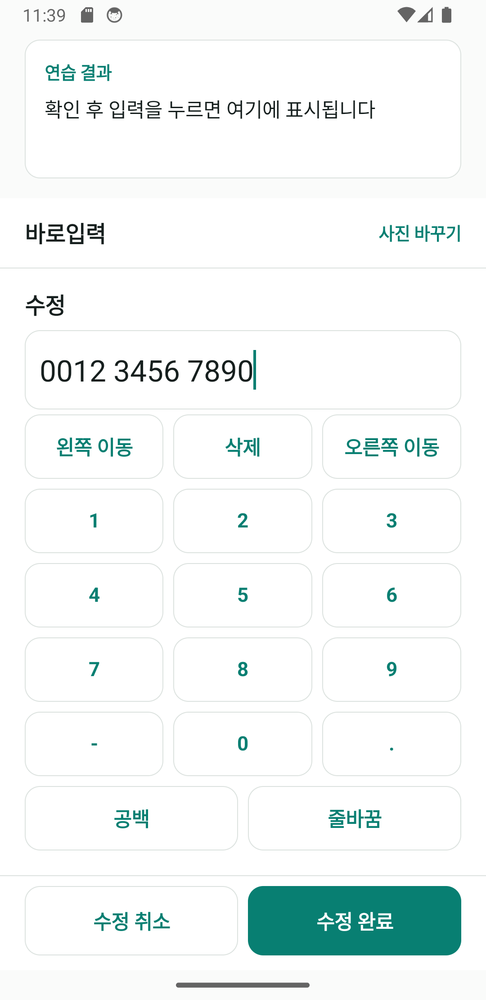 |
| 8 카메라 | 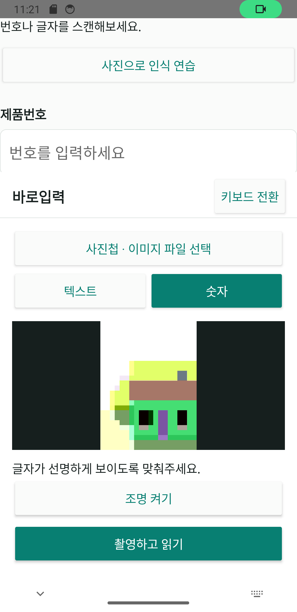 | 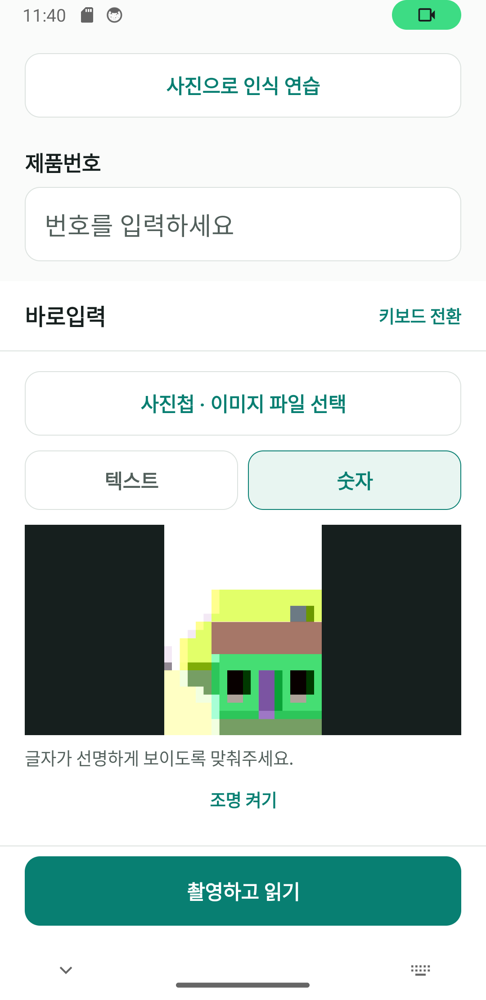 |
| 9 시스템 선택기 |  | 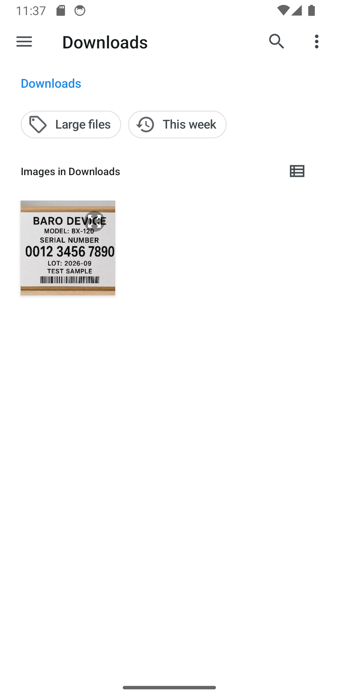 |

### 선택 복귀·완료·빈 결과

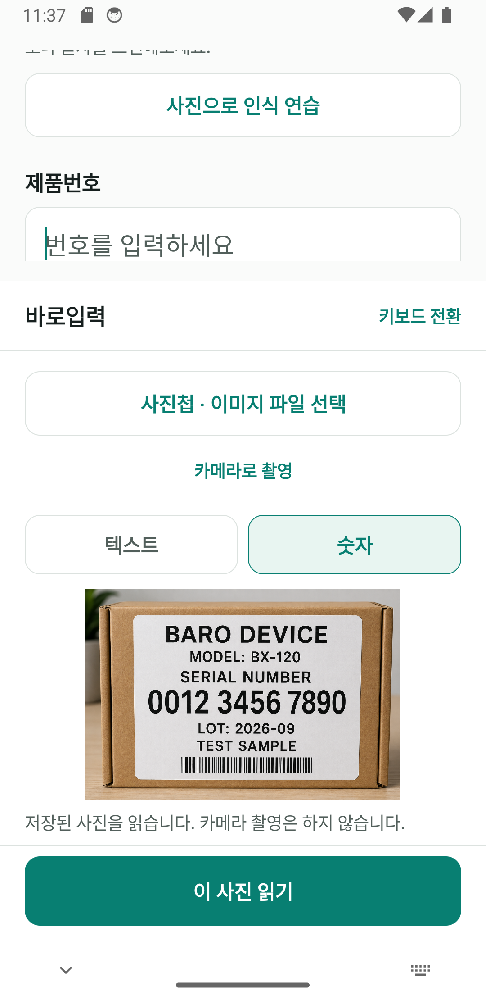
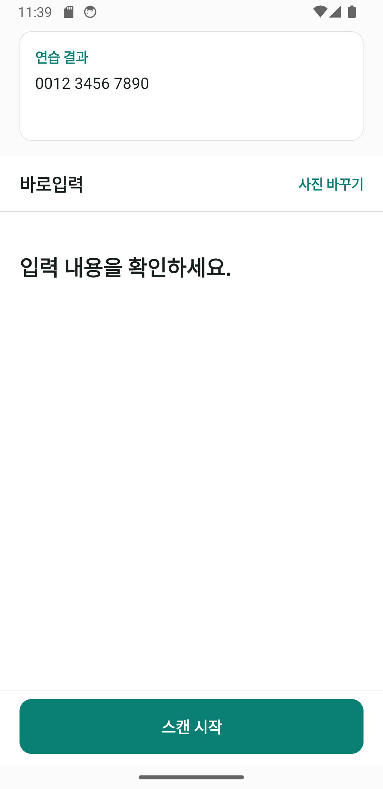
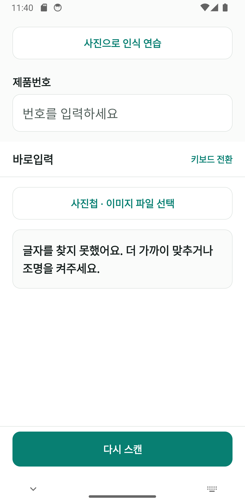

## 검증 및 한계

- `assembleDebug`, `testDebugUnitTest`, `lintDebug` 통과. 총 23개 테스트.
- 작은 패널·글자 130%에서 입력/수정 완료 버튼이 화면 안에 유지되는 회귀 테스트를 추가했습니다.
- 준비 화면 초기 여백이 insets 전달 전에 사라지지 않는지 검증했습니다.
- 에뮬레이터에서 카메라 미리보기, 이미지 선택 복귀, 샘플 OCR, 줄 선택, 숫자 수정, 명시적 입력, 빈 결과 복구 화면을 확인했습니다.
- 사진 연습은 기본 화면에서 수정 키와 완료 동작이 함께 보입니다. 320dp·130%에서는 키 목록을 스크롤해야 하지만 완료 버튼은 고정됩니다.
- 큰 글자 점검 중 결과 안내 잘림과 줄바꿈 버튼 높이 차이를 발견하여 추가 보완했습니다. `11-`~`16-` 캡처는 이 보완 전 발견 기록을 포함합니다.
- 카메라 이미지는 에뮬레이터의 테스트 영상입니다. 실제 촬영 품질, TalkBack 전체 탐색, 가로 화면, 모든 Android 버전·제조사별 선택기는 별도 검증이 필요합니다.
- 로딩 상태는 짧게 지나가므로 독립된 안정 화면 캡처를 채택하지 않았습니다. 비밀번호·권한 거부·파일 손상 등 모든 오류 분기의 시각 검증을 했다는 의미는 아닙니다.
